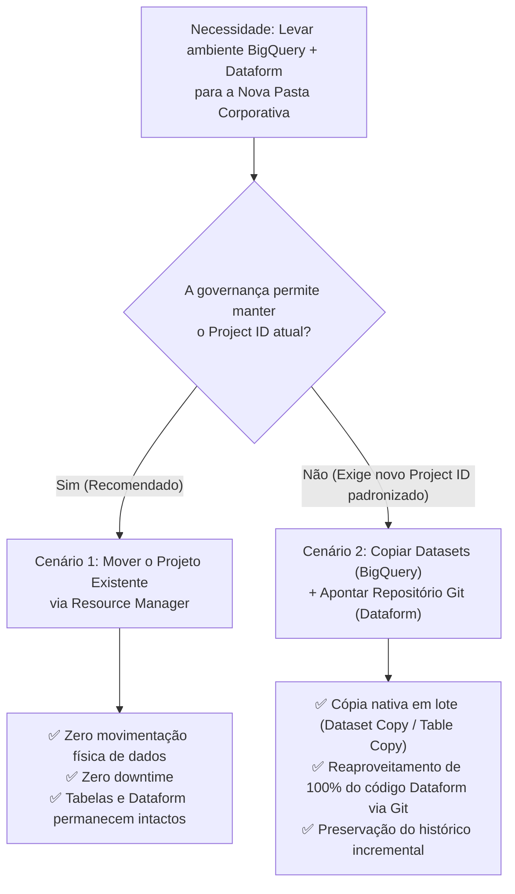

# 📘 Manual de Migração: BigQuery & Dataform para Nova Pasta Corporativa

> **Objetivo:** Orientar equipes de Engenharia de Dados e Arquitetura Cloud sobre como reorganizar ou migrar um projeto existente no Google Cloud (contendo tabelas históricas, consolidações no **BigQuery** e pipelines/ETLs no **Dataform**) para uma **nova pasta corporativa**, **sem necessidade de recriar recursos do zero** e **sem perda de dados acumulados**.

---

## 🧭 Resumo Executivo e Árvore de Decisão

Ao estruturar uma nova hierarquia corporativa no Google Cloud (*Organization > Folders > Projects*), **não é necessário descartar nem recriar tabelas ou pipelines existentes**. Existem dois caminhos oficiais suportados pelo Google Cloud, dependendo da diretriz de governança da sua organização:



| Critério | Cenário 1: Mover o Projeto Existente (Recomendado) | Cenário 2: Migrar para um Novo Projeto (`Project ID` novo) |
| :--- | :--- | :--- |
| **Movimentação de dados** | Nenhuma (apenas alteração de metadados no Resource Manager) | Cópia nativa gerenciada via *BigQuery Data Transfer Service* ou SQL |
| **Tempo de indisponibilidade** | Zero (*Zero Downtime*) | Mínimo (janela de *cutover* dos agendamentos) |
| **Impacto no `Project ID`** | Mantém o mesmo `Project ID` e `Project Number` | Passa a utilizar o novo `Project ID` corporativo |
| **Impacto no Dataform** | Nenhum (continua rodando no mesmo projeto) | Basta conectar o novo repositório Dataform ao mesmo Git e atualizar `defaultProject` |
| **Perda de histórico acumulado** | **Nenhuma** | **Nenhuma** (executando tabelas incrementais sem *Full Refresh*) |

---

## Cenário 1 (Recomendado): Mover o Projeto Existente para a Nova Pasta Corporativa

No Google Cloud, todos os recursos do BigQuery (datasets, tabelas, partições históricas, views, rotinas) e do Dataform (repositórios, workspaces, agendamentos) estão vinculados ao **Projeto**. Mover um projeto para uma nova Pasta (*Folder*) no **Resource Manager** atualiza apenas a sua posição na árvore hierárquica.

### O que é preservado vs. O que muda

* **Permanece 100% intacto:**
  * `Project ID` e `Project Number`.
  * Todos os datasets, tabelas, partições e histórico acumulado no BigQuery.
  * Todos os repositórios, *workspaces*, *Release Configurations* e *Workflow Configurations* do Dataform.
  * Contas de Serviço (*Service Accounts*), chaves e vínculo de faturamento (*Billing Account*).
* **Pontos de Atenção (O que muda):**
  * **Herança de IAM:** O projeto deixa de herdar permissões (*IAM Roles*) da pasta antiga e passa a herdar as permissões configuradas na nova pasta corporativa.
  * **Políticas da Organização (*Organization Policies*):** O projeto passa a respeitar as restrições (*constraints*) definidas na nova pasta corporativa.

---

### Passo a Passo — Caso 1A: Movimentação dentro da mesma Organização GCP

#### 1. Validar Permissões Necessárias (IAM)
O responsável pela operação deve possuir os seguintes papéis tanto na **pasta/organização de origem** quanto na **nova pasta corporativa de destino**:
* `roles/resourcemanager.projectMover` (*Project Mover*)
* `roles/resourcemanager.projectEditor` (*Project Editor*)

#### 2. Verificar Heranças de Permissão Antes da Movimentação
Identifique se alguma *Service Account* ou grupo de usuários depende de permissões atribuídas na pasta antiga. Caso positivo, replique essas permissões diretamente no nível do projeto ou na nova pasta corporativa.

#### 3. Executar a Movimentação do Projeto
* **Pelo Console do Google Cloud:**
  1. Acesse **IAM e Admin > Gerenciar recursos** ([Cloud Resource Manager](https://console.cloud.google.com/cloud-resource-manager)).
  2. Localize o projeto de origem (`<ID_PROJETO_ORIGEM>`).
  3. Clique no menu de ações (**⋮**) na linha do projeto e selecione **Mover** (*Move*).
  4. Selecione a **Nova Pasta Corporativa** como destino e confirme clicando em **Mover**.

* **Pela CLI (`gcloud`):**
  ```bash
  gcloud beta projects move <ID_PROJETO_ORIGEM> \
    --folder=<ID_PASTA_CORPORATIVA>
  ```

---

### Passo a Passo — Caso 1B: Projeto "Sem Organização" (*No Organization*) ou em Outra Organização

Se o projeto foi criado originalmente de forma isolada (sem vínculo a uma organização) ou em outro domínio corporativo:

1. **Inspecionar a ancestralidade atual do projeto:**
   ```bash
   gcloud projects get-ancestors <ID_PROJETO_ORIGEM>
   ```
2. **Realizar a migração para a Organização/Pasta Corporativa:**
   * Caso esteja em outra organização, configure as políticas `constraints/resourcemanager.allowedExportDestinations` (na origem) e `constraints/resourcemanager.allowedImportSources` (no destino).
   * Caso esteja **sem organização**, siga o procedimento de importação de projetos *standalone* garantindo que o usuário possua permissões administrativas no projeto e `roles/resourcemanager.projectCreator` / `roles/resourcemanager.projectMover` na pasta de destino.
   * Execute a movimentação:
     ```bash
     gcloud beta projects move <ID_PROJETO_ORIGEM> \
       --folder=<ID_PASTA_CORPORATIVA>
     ```

### 🔗 Documentação Oficial — Cenário 1
* [Hierarquia de recursos do BigQuery (Organizações, Pastas e Projetos)](https://docs.cloud.google.com/bigquery/docs/resource-hierarchy)
* [Mover projetos entre pastas no Resource Manager](https://docs.cloud.google.com/resource-manager/docs/moving-projects-folders)
* [Visão geral da migração de projetos entre organizações](https://docs.cloud.google.com/resource-manager/docs/project-migration)
* [Casos especiais: Migrar projetos sem organização vinculada](https://docs.cloud.google.com/resource-manager/docs/handle-special-cases#migrating_projects_no_org)
* [Como planejar e executar a migração de projetos](https://docs.cloud.google.com/resource-manager/docs/perform-migration)

---

## Cenário 2: Migrar Dados (BigQuery) e ETLs (Dataform) para um NOVO Projeto na Pasta Corporativa

Caso a governança exija a criação de um **novo projeto** (ex.: para adotar um novo padrão de nomenclatura de `Project ID`) dentro da pasta corporativa, todo o trabalho já construído e todos os dados históricos podem ser migrados em **duas etapas**.

---

### Etapa 2.1: Copiar os Datasets e Tabelas Acumuladas do BigQuery

Não é necessário exportar tabelas para o Cloud Storage nem reprocessar cargas passadas. O BigQuery possui mecanismos nativos de cópia de datasets e tabelas.

#### Opção A (Recomendada para Múltiplas Tabelas): *BigQuery Dataset Copy*
Copia todas as tabelas nativas e partições históricas de um dataset do projeto antigo para o projeto novo utilizando o *BigQuery Data Transfer Service*.

1. **Permissões necessárias:**
   * No projeto de **origem** (`<ID_PROJETO_ORIGEM>`): `roles/bigquery.dataViewer`
   * No projeto de **destino** (`<ID_PROJETO_DESTINO>`): `roles/bigquery.admin` (ou `bigquery.transfers.update`, `bigquery.datasets.update`, `bigquery.tables.create`)
2. **Criar o dataset de destino no novo projeto:**
   ```bash
   bq mk --dataset \
     --location=<REGIAO_DO_DATASET> \
     <ID_PROJETO_DESTINO>:<DATASET_DESTINO>
   ```
3. **Configurar e disparar a cópia do dataset:**
   * **Via Console:** No BigQuery Studio, selecione o dataset de origem -> clique em **Copiar** (*Copy*) -> informe o projeto e dataset de destino.
   * **Via CLI (`bq`):**
     ```bash
     bq mk --transfer_config \
       --project_id=<ID_PROJETO_DESTINO> \
       --data_source=cross_region_copy \
       --target_dataset=<DATASET_DESTINO> \
       --display_name="Migracao Dataset - <DATASET_ORIGEM>" \
       --params='{"source_dataset_id":"<DATASET_ORIGEM>","source_project_id":"<ID_PROJETO_ORIGEM>","overwrite_destination_table":"true"}'
     ```

> [!IMPORTANT]
> **Comportamento com Views e Rotinas:** O serviço de *Dataset Copy* transfere todas as **tabelas nativas e partições**, mas não copia *Views* ou *Routines (UDFs/Procedures)*. No entanto, como a camada de transformação utiliza o **Dataform**, **o próprio Dataform recriará todas as Views, rotinas e dependências automaticamente** na Etapa 2.2.

#### Opção B (Por Tabela Individual): SQL DDL (`COPY` / `CLONE`) ou `bq cp`
Conforme documentado no guia de [Gerenciamento de Tabelas](https://docs.cloud.google.com/bigquery/docs/managing-tables#copy-table), para tabelas na mesma região é possível executar cópias diretas ou clones rápidos:

* **Via SQL DDL (`CREATE TABLE ... COPY`):**
  ```sql
  CREATE TABLE `<ID_PROJETO_DESTINO>.<DATASET_DESTINO>.<NOME_TABELA>`
  COPY `<ID_PROJETO_ORIGEM>.<DATASET_ORIGEM>.<NOME_TABELA>`;
  ```
* **Via SQL DDL (`CREATE TABLE ... CLONE` — zero custo inicial de armazenamento):**
  ```sql
  CREATE TABLE `<ID_PROJETO_DESTINO>.<DATASET_DESTINO>.<NOME_TABELA>`
  CLONE `<ID_PROJETO_ORIGEM>.<DATASET_ORIGEM>.<NOME_TABELA>`;
  ```
* **Via CLI (`bq cp`):**
  ```bash
  bq cp -f \
    <ID_PROJETO_ORIGEM>:<DATASET_ORIGEM>.<NOME_TABELA> \
    <ID_PROJETO_DESTINO>:<DATASET_DESTINO>.<NOME_TABELA>
  ```

---

### Etapa 2.2: Migrar os ETLs e Consolidações do Dataform

Como os pipelines do Dataform são declarativos (`.sqlx` / `.js`), toda a inteligência de negócio é migrada conectando o novo projeto ao repositório Git existente:

1. **Sincronizar o Repositório Git Atual:**
   * No projeto antigo, verifique se todos os *workspaces* de desenvolvimento tiveram suas alterações enviadas (*commit & push*) para a branch principal do repositório Git (GitHub, GitLab, Bitbucket ou Azure DevOps).
2. **Criar o Repositório Dataform no Novo Projeto:**
   * No projeto `<ID_PROJETO_DESTINO>`, acesse **BigQuery > Dataform** e crie um novo repositório.
   * Conecte-o ao **mesmo repositório Git** utilizando o Secret Manager do novo projeto para armazenar o token/chave SSH.
3. **Atualizar a Configuração de Projeto Padrão (`defaultProject`):**
   * No arquivo `workflow_settings.yaml` (ou `dataform.json` em versões anteriores), atualize o projeto alvo:
     ```yaml
     defaultProject: <ID_PROJETO_DESTINO>
     defaultLocation: <REGIAO_DO_DATASET>
     defaultDataset: dataform
     defaultAssertionDataset: dataform_assertions
     ```
   * *Dica de Governança:* Você também pode sobrescrever o `Project ID` diretamente nas **Release Configurations** (*Configurações de Lançamento*) do Dataform sem alterar o arquivo estático, permitindo múltiplos ambientes (Dev/Prod).
   * Revise os arquivos de declaração de origens (`type: "declaration"` em `definitions/`) caso algum aponte explicitamente (`database: "<ID_PROJETO_ORIGEM>"`) para tabelas que mudaram de projeto.
4. **Conceder Permissões de IAM ao Dataform no Novo Projeto:**
   * Atribua à *Service Account* de execução do Dataform os papéis:
     * `roles/bigquery.dataEditor`
     * `roles/bigquery.dataViewer`
     * `roles/bigquery.jobUser`
5. **Executar o Pipeline Preservando o Histórico Acumulado (Regra de Ouro):**
   * Ao disparar a primeira execução no novo projeto, **NÃO selecione a opção `Run with full refresh` (`--full-refresh`)** nas tabelas incrementais (`type: "incremental"`) que já foram copiadas na Etapa 2.1.
   * Com isso:
     1. O Dataform **recriará automaticamente todas as Views** no novo projeto;
     2. Para as tabelas incrementais já copiadas, o Dataform **manterá todo o histórico acumulado** e processará apenas a janela incremental nova (`WHEN incremental()`).

### 🔗 Documentação Oficial — Cenário 2
* [Gerenciar e copiar tabelas no BigQuery (`managing-tables`)](https://docs.cloud.google.com/bigquery/docs/managing-tables#copy-table)
* [Copiar datasets entre projetos no BigQuery (`copying-datasets`)](https://docs.cloud.google.com/bigquery/docs/copying-datasets)
* [Introdução a Clones de Tabelas no BigQuery](https://docs.cloud.google.com/bigquery/docs/table-clones-intro)
* [Conectar um repositório do Dataform a um provedor Git terceirizado](https://docs.cloud.google.com/dataform/docs/connect-repository)
* [Gerenciar compilação com Release Configurations no Dataform](https://docs.cloud.google.com/dataform/docs/release-configurations)
* [Funcionamento de Tabelas Incrementais no Dataform](https://docs.cloud.google.com/dataform/docs/incremental-tables)

---

## ✅ Checklist de Validação Pós-Migração

- [ ] **Permissões de IAM validadas:** Usuários, ferramentas de BI (Looker / Looker Studio) e *Service Accounts* possuem acesso ao projeto na nova pasta corporativa.
- [ ] **Contagem de linhas e partições conferida:** No Cenário 2, validar que as tabelas copiadas no `<ID_PROJETO_DESTINO>` possuem a mesma volumetria do `<ID_PROJETO_ORIGEM>`.
- [ ] **Compilação do Dataform sem erros:** Verificar no *Workspace* ou na *Release Configuration* se o grafo de dependências (DAG) do Dataform aponta integralmente para o projeto correto.
- [ ] **Primeira execução incremental concluída:** Validar que a execução agendada do Dataform rodou sem *Full Refresh*, mantendo os dados históricos intactos.
- [ ] **Desativação de agendamentos antigos (Cenário 2):** Pausar os *Workflow Configurations* no projeto antigo para evitar processamento duplicado.
