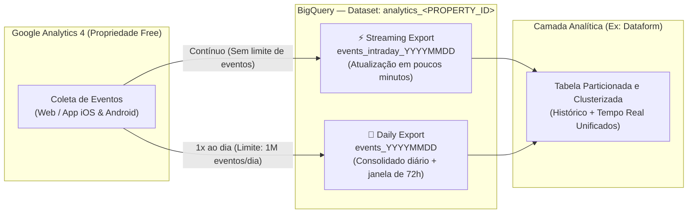

# 📘 Manual de Configuração e Melhores Práticas: Ingestão Streaming do GA4 (Free) no BigQuery

> **Objetivo:** Orientar equipes de Engenharia de Dados, Martech e Arquitetura Cloud sobre como configurar a exportação contínua (**Streaming Export**) de propriedades gratuitas (**Standard / Free**) do **Google Analytics 4 (GA4)** para o **BigQuery**, detalhando pré-requisitos, limites operacionais, arquitetura de tabelas (`events_intraday_*` vs. `events_*`) e melhores práticas de modelagem e otimização de custos.

---

## 🧭 Visão Geral: Como Funciona o Streaming no GA4 Free

O conector nativo **BigQuery Export** do Google Analytics 4 permite exportar eventos brutos sem amostragem (*unsampled*) diretamente para o BigQuery. Nas propriedades gratuitas (**GA4 Standard / Free**), existem duas modalidades de exportação que funcionam de maneira complementar:



### Comparativo: Exportação Streaming vs. Exportação Diária (GA4 Free)

| Característica | Exportação Streaming (`events_intraday_YYYYMMDD`) | Exportação Diária (`events_YYYYMMDD`) |
| :--- | :--- | :--- |
| **Latência dos dados** | **Quase em tempo real** (disponível em poucos minutos) | Lote diário (geralmente concluído à tarde no fuso da propriedade) |
| **Limite de volume (GA4 Free)** | **Sem limite de eventos** | **Até 1 milhão de eventos/dia** (pausa se excedido de forma consistente) |
| **Requisito de Faturamento GCP** | **Obrigatório ter Conta de Faturamento (*Billing*) ativa** no GCP | Funciona no *BigQuery Sandbox* (sujeito ao limite de 10 GB) ou com *Billing* ativo |
| **Custo de ingestão no BigQuery** | ~**US\$ 0,05 por GB** ingerido (~600 mil eventos $\approx$ 1 GB) | **Gratuito** (cobra-se apenas armazenamento e consultas no BigQuery) |
| **Atribuição de novos usuários** | **Não inclui** `traffic_source.name`, `source` e `medium` de novos usuários | **Completa** (inclui atribuição consolidada do usuário e atualizações por até 72h) |
| **Ciclo de vida da tabela** | Tabela temporária de preparo; **é excluída automaticamente** após a geração da `events_YYYYMMDD` (quando ambas estão ativas) | Tabela permanente (`sharded table` por data) |

---

## 🛠️ Passo a Passo de Configuração

### Etapa 1: Preparar o Projeto no Google Cloud (Pré-requisitos)

Antes de iniciar a vinculação no painel do GA4, garanta os seguintes pré-requisitos no projeto do Google Cloud (`<ID_DO_PROJETO_GCP>`):

1. **Conta de Faturamento (*Cloud Billing*) Ativa (Obrigatório para Streaming):**
   * O modo **Streaming** utiliza a API de gravação contínua do BigQuery e **não funciona no BigQuery Sandbox**.
   * Acesse **Faturamento** no Console do Google Cloud e confirme que há uma conta de faturamento válida vinculada ao projeto.
   * > **⚠️ Atenção:** Se o faturamento for interrompido ou invalidado, a exportação falhará e **o GA4 não reprocessa (backfill) dados de períodos em que o faturamento esteve inativo**.
2. **Ativar a API do BigQuery:**
   * Acesse **APIs e Serviços > Biblioteca**, busque por **BigQuery API** (`bigquery.googleapis.com`) e clique em **Ativar**.
3. **Validar Políticas da Organização (*Organization Policies*):**
   * Se o projeto estiver dentro de uma Organização/Pasta corporativa com restrições de segurança:
     * Verifique se a política `constraints/iam.allowedPolicyMemberDomains` permite a adição da conta de serviço do Google Analytics (`firebase-measurement@system.gserviceaccount.com`) ou da identidade de recurso integrada do Analytics.
     * Verifique se a política `constraints/gcp.resourceLocations` permite a região onde o dataset será criado (ex.: `southamerica-east1` ou `US`).
4. **Permissões necessárias para quem fará a vinculação:**
   * **No Google Analytics 4:** Permissão de **Editor** ou **Administrador** no nível da propriedade.
   * **No Projeto Google Cloud:** Papel de **Proprietário (`roles/owner`)** no projeto do BigQuery (ou papel contendo `resourcemanager.projects.get`, `resourcemanager.projects.getIamPolicy`, `resourcemanager.projects.setIamPolicy`, `serviceusage.services.enable` e `serviceusage.services.get`).

---

### Etapa 2: Vincular a Propriedade do GA4 ao BigQuery

1. Acesse o [Google Analytics](https://analytics.google.com/) e clique em **Administrador** (ícone de engrenagem no canto inferior esquerdo).
2. Na coluna da propriedade, na seção **Vínculos de produtos** (*Product links*), clique em **Vinculações do BigQuery** (*BigQuery links*).
3. Clique no botão **Vincular** (*Link*).
4. Clique em **Escolher um projeto do BigQuery** e selecione o projeto `<ID_DO_PROJETO_GCP>` preparado na Etapa 1. Clique em **Confirmar**.
   * *Nota:* Se a propriedade do GA4 já estiver vinculada ao **Firebase**, selecione o mesmo projeto GCP associado ao Firebase.
5. **Selecione a Localização dos Dados (Região do Dataset):**
   * **Boa Prática Crítica:** Escolha a **mesma região** onde estão armazenados os seus demais datasets do BigQuery e pipelines do Dataform (por exemplo, `southamerica-east1` em São Paulo ou multirregião `US`). Isso evita custos de replicação e permite fazer `JOIN` direto com dados internos.
6. Clique em **Próxima**.
7. **Configurar Fluxos de Dados e Filtragem de Eventos:**
   * Clique em **Configurar eventos e fluxos de dados** para selecionar quais *Data Streams* (Web, iOS, Android) serão exportados.
   * Caso deseje reduzir custos ou evitar atingir o limite de 1 milhão de eventos na exportação diária, adicione à lista **Eventos a serem excluídos** aqueles eventos automáticos que não tenham utilidade analítica para o seu negócio.
8. **Selecionar a Frequência de Exportação:**
   * Marque **ambas** as opções (recomendado para propriedades com até 1 milhão de eventos/dia):
     * [x] **Diária** (*Daily*) — Garante a tabela histórica consolidada e com atribuição completa.
     * [x] **Streaming** (*Contínua*) — Garante a tabela `events_intraday_YYYYMMDD` em tempo real ao longo do dia.
   * *(Caso sua propriedade GA4 Free ultrapasse 1 milhão de eventos por dia de forma constante e você não possa filtrar eventos, marque **Streaming** e implemente a rotina de persistência diária descrita na seção de Melhores Práticas abaixo).*
9. Clique em **Próxima**, revise as configurações e clique em **Enviar**.

---

### Etapa 3: Verificar o Agente de Serviço e o Dataset Criado

1. Após criar a vinculação, o GA4 provisionará automaticamente o dataset chamado `analytics_<ID_DA_PROPRIEDADE>` no BigQuery (os primeiros dados de streaming começam a aparecer em poucos minutos, podendo levar até 24h na criação inicial).
2. No Console do Google Cloud (**IAM e Admin > IAM**), verifique se a identidade integrada do vínculo (ou a conta de serviço `firebase-measurement@system.gserviceaccount.com`) consta com o papel `roles/bigquery.user` no projeto e proprietária do dataset `analytics_<ID_DA_PROPRIEDADE>`.
   * > **⚠️ Nunca remova essa conta de serviço:** Se ela for removida do IAM, todas as exportações do GA4 serão interrompidas imediatamente.

---

## 🏆 Melhores Práticas de Arquitetura, Custos e Engenharia de Dados

### 1. Entenda as Limitações da Tabela `events_intraday_YYYYMMDD`
* **Sem SLA de completude (*Best-Effort*):** Eventos gerados quando o dispositivo do usuário estava offline ou enviados com atraso via *Measurement Protocol* podem não aparecer na `events_intraday_YYYYMMDD`, sendo consolidados apenas na `events_YYYYMMDD` (que recebe atualizações retroativas por até **72 horas**).
* **Atribuição de Aquisição do Usuário (`traffic_source`):** Na tabela `events_intraday_YYYYMMDD`, o registro `traffic_source` (que representa o primeiro canal que adquiriu o usuário) vem vazio para **novos usuários** porque o GA4 leva até 24h para processar a atribuição de aquisição.
  * **Como contornar em tempo real:** Para analisar a origem/mídia da sessão ou do evento em tempo real no Streaming, consulte a struct **`collected_traffic_source`** (campos `manual_source`, `manual_medium`, `manual_campaign_name`, `gclid`) ou extraia diretamente de **`event_params`** (`source`, `medium`, `campaign`, `page_location`, `page_referrer`).

### 2. Estratégia para Propriedades GA4 Free com Mais de 1 Milhão de Eventos/Dia
Nas propriedades gratuitas, a exportação **Diária** trava se ultrapassar **1 milhão de eventos/dia**, mas a exportação **Streaming não possui limite de eventos**.
* **Se o seu volume for $< 1\text{ milhão}$ de eventos/dia:** Mantenha **Diária + Streaming** ativos. Use `events_YYYYMMDD` para os dias fechados e `events_intraday_YYYYMMDD` apenas para o dia corrente (`CURRENT_DATE`).
* **Se o seu volume for $> 1\text{ milhão}$ de eventos/dia no GA4 Free:**
  1. Utilize o filtro de exclusão de eventos na vinculação do GA4 para cortar eventos ruidosos e ficar abaixo de 1M/dia; **OU**
  2. Caso precise de todos os eventos via Streaming, agende um job diário (ex.: via **Dataform** ou **Scheduled Queries** logo após a meia-noite) que copie/incremente os registros da `events_intraday_YYYYMMDD` do dia anterior para uma tabela histórica própria particionada antes que ela seja descartada ou caso a exportação diária esteja desativada.

### 3. NUNCA Conecte Dashboards Diretamente em `events_*` com `SELECT *`
As tabelas exportadas pelo GA4 são divididas por sufixo de data (*sharded tables*) e possuem múltiplos campos aninhados (`ARRAY<STRUCT>` como `event_params` e `items`). Consultar `analytics_<PROPERTY_ID>.events_*` diretamente a partir do Looker Studio ou Power BI sem filtro de `_TABLE_SUFFIX` escaneará todo o histórico a cada clique, gerando custos elevados de processamento (*On-Demand*).

**Padrão Recomendado (Camada Silver/Gold via Dataform):**
Crie uma tabela incremental no BigQuery/Dataform que:
1. seja **Particionada por `event_date`** (`PARTITION BY event_date`);
2. seja **Clusterizada por `event_name` e `user_pseudo_id`** (`CLUSTER BY event_name, user_pseudo_id`);
3. desaninhe (`UNNEST`) os parâmetros principais em colunas planas (*flat columns*).

---

## 💻 Exemplo Prático de SQL: Unificando Histórico Diário + Streaming em Tempo Real

A consulta abaixo demonstra a melhor prática para consultar de forma unificada e econômica tanto os dias consolidados (`events_YYYYMMDD`) quanto o dia atual em tempo real (`events_intraday_YYYYMMDD`), já extraindo parâmetros de sessão e evento com uma função auxiliar:

```sql
-- Exemplo: Consulta otimizada unindo últimos 7 dias fechados + Streaming de hoje
SELECT
  PARSE_DATE('%Y%m%d', event_date) AS data_evento,
  TIMESTAMP_MICROS(event_timestamp) AS dh_evento_utc,
  event_name,
  user_pseudo_id,
  user_id,
  -- Extração otimizada de parâmetros do ARRAY<STRUCT> event_params via Subquery Escalar
  (SELECT value.string_value FROM UNNEST(event_params) WHERE key = 'page_location') AS page_location,
  (SELECT value.int_value FROM UNNEST(event_params) WHERE key = 'ga_session_id') AS ga_session_id,
  -- Utilizando collected_traffic_source (disponível também no Streaming Intraday!)
  collected_traffic_source.manual_source AS evento_source,
  collected_traffic_source.manual_medium AS evento_medium,
  collected_traffic_source.manual_campaign_name AS evento_campaign,
  device.category AS device_category,
  geo.country AS country,
  geo.region AS region,
  -- Identificador da origem da tabela (diária consolidada vs intraday streaming)
  IF(_TABLE_SUFFIX LIKE 'intraday_%', 'STREAMING_INTRADAY', 'DAILY_CONSOLIDATED') AS origem_tabela
FROM
  `<ID_DO_PROJETO_GCP>.analytics_<ID_DA_PROPRIEDADE>.events_*`
WHERE
  -- 1. Lê apenas as tabelas diárias consolidadas dos últimos 7 dias
  (_TABLE_SUFFIX BETWEEN FORMAT_DATE('%Y%m%d', DATE_SUB(CURRENT_DATE(), INTERVAL 7 DAY))
                     AND FORMAT_DATE('%Y%m%d', DATE_SUB(CURRENT_DATE(), INTERVAL 1 DAY)))
  OR
  -- 2. Une com a tabela de Streaming (intraday) apenas se a tabela diária correspondente ainda não existir
  (_TABLE_SUFFIX = CONCAT('intraday_', FORMAT_DATE('%Y%m%d', CURRENT_DATE())))
```

---

### Exemplo de Modelo Incremental no Dataform (`definitions/ga4_events_flat.sqlx`)

Se você utiliza o **Dataform** para transformar os dados do GA4, este modelo incremental reprocessa os últimos 3 dias (capturando atualizações tardias de até 72h da exportação diária) e inclui os dados em tempo real do `events_intraday_*`:

```sql
config {
  type: "incremental",
  schema: "analytics_curated",
  name: "ga4_events_flat",
  bigquery: {
    partitionBy: "event_date_parsed",
    clusterBy: ["event_name", "user_pseudo_id"],
    updatePartitionFilter:
      "event_date_parsed >= DATE_SUB(CURRENT_DATE(), INTERVAL 3 DAY)"
  },
  description: "Tabela de eventos GA4 particionada e desaninhada (Diário + Streaming)"
}

pre_operations {
  -- Em execuções incrementais, limpa os últimos 3 dias para substituir pelos dados consolidados + intraday atual
  ${when(incremental(),
    `DELETE FROM ${self()} WHERE event_date_parsed >= DATE_SUB(CURRENT_DATE(), INTERVAL 3 DAY);`
  )}
}

SELECT
  PARSE_DATE('%Y%m%d', event_date) AS event_date_parsed,
  TIMESTAMP_MICROS(event_timestamp) AS event_timestamp_utc,
  event_name,
  user_pseudo_id,
  user_id,
  (SELECT value.string_value FROM UNNEST(event_params) WHERE key = 'page_location') AS page_location,
  (SELECT value.string_value FROM UNNEST(event_params) WHERE key = 'page_title') AS page_title,
  (SELECT value.int_value FROM UNNEST(event_params) WHERE key = 'ga_session_id') AS ga_session_id,
  (SELECT value.int_value FROM UNNEST(event_params) WHERE key = 'engagement_time_msec') AS engagement_time_msec,
  collected_traffic_source.manual_source AS session_source,
  collected_traffic_source.manual_medium AS session_medium,
  collected_traffic_source.manual_campaign_name AS session_campaign,
  traffic_source.source AS first_user_source,
  traffic_source.medium AS first_user_medium,
  traffic_source.name AS first_user_campaign,
  device.category AS device_category,
  device.operating_system AS operating_system,
  geo.country AS country,
  geo.region AS region,
  geo.city AS city
FROM
  `<ID_DO_PROJETO_GCP>.analytics_<ID_DA_PROPRIEDADE>.events_*`
WHERE
  ${when(incremental(),
    `(_TABLE_SUFFIX BETWEEN FORMAT_DATE('%Y%m%d', DATE_SUB(CURRENT_DATE(), INTERVAL 3 DAY))
                        AND FORMAT_DATE('%Y%m%d', CURRENT_DATE()))
     OR (_TABLE_SUFFIX = CONCAT('intraday_', FORMAT_DATE('%Y%m%d', CURRENT_DATE())))`,
    `(_TABLE_SUFFIX >= '20240101' AND _TABLE_SUFFIX NOT LIKE 'intraday_%')
     OR (_TABLE_SUFFIX = CONCAT('intraday_', FORMAT_DATE('%Y%m%d', CURRENT_DATE())))`
  )}
```

---

## ✅ Checklist de Validação e Governança

- [ ] **Faturamento ativo no GCP:** Conta de faturamento vinculada ao projeto (evita interrupção do Streaming).
- [ ] **Mesma região selecionada:** O dataset `analytics_<ID_DA_PROPRIEDADE>` foi configurado na mesma localização que os demais datasets do Data Warehouse.
- [ ] **Proteção da Conta de Serviço:** A conta `firebase-measurement@system.gserviceaccount.com` (ou identidade integrada do vínculo) permanece intacta no IAM do projeto.
- [ ] **Fuso horário definitivo na propriedade GA4:** Evitar alterações futuras de fuso horário na propriedade do GA4, pois mudar o fuso altera o corte das tabelas diárias e intradiárias.
- [ ] **Filtro de `_TABLE_SUFFIX` aplicado em todas as queries:** Nenhuma consulta lê `events_*` sem restringir o intervalo de `_TABLE_SUFFIX`.

---

## 🔗 Documentação Oficial de Referência

* [Visão geral do BigQuery Export no GA4 (Diário vs. Streaming)](https://support.google.com/analytics/answer/9358801?hl=pt-BR)
* [Como configurar o BigQuery Export no Google Analytics 4](https://support.google.com/analytics/answer/9823238?hl=pt-BR)
* [Esquema de colunas e eventos do BigQuery Export (`events_` e `events_intraday_`)](https://support.google.com/analytics/answer/7029846?hl=pt-BR)
* [Mensagens de erro e solução de problemas do BigQuery Export](https://support.google.com/analytics/answer/7031061?hl=pt-BR)
* [Entendendo as diferenças entre a interface do GA4 e os dados do BigQuery](https://developers.google.com/analytics/blog/2023/bigquery-vs-ui?hl=pt-br)
* [Preços de ingestão via Streaming no BigQuery](https://cloud.google.com/bigquery/pricing#data_ingestion_pricing)
